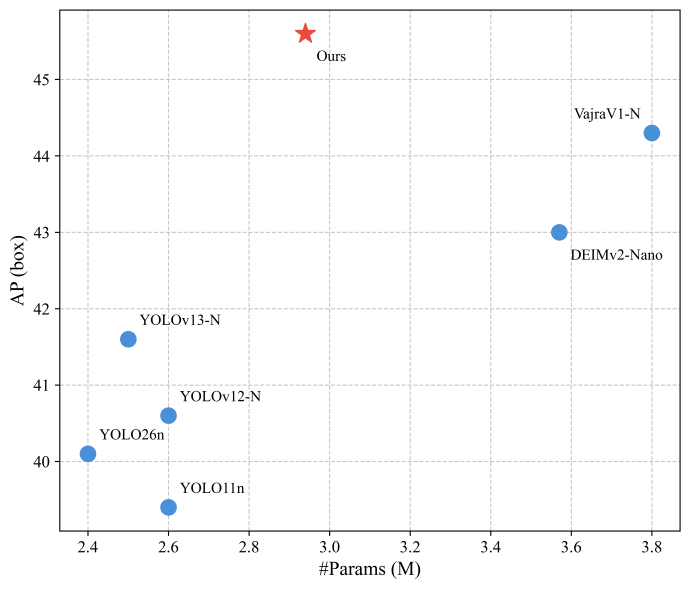
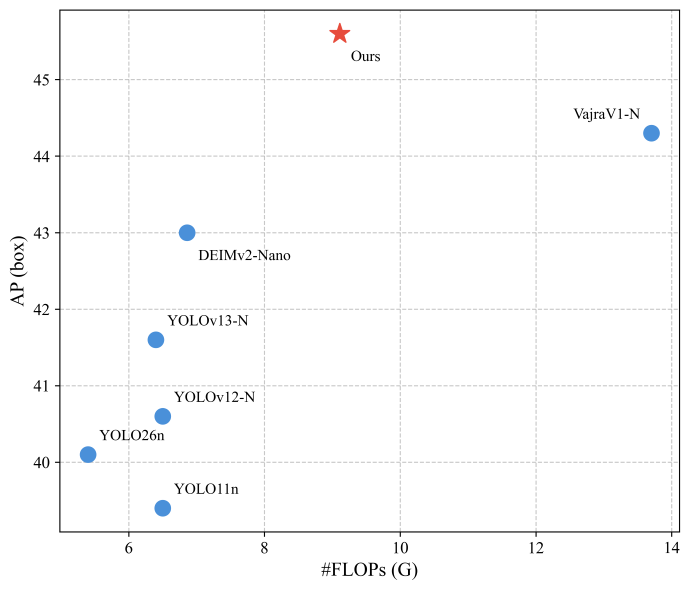
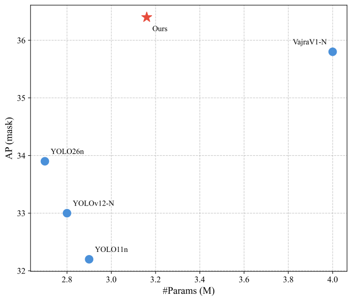
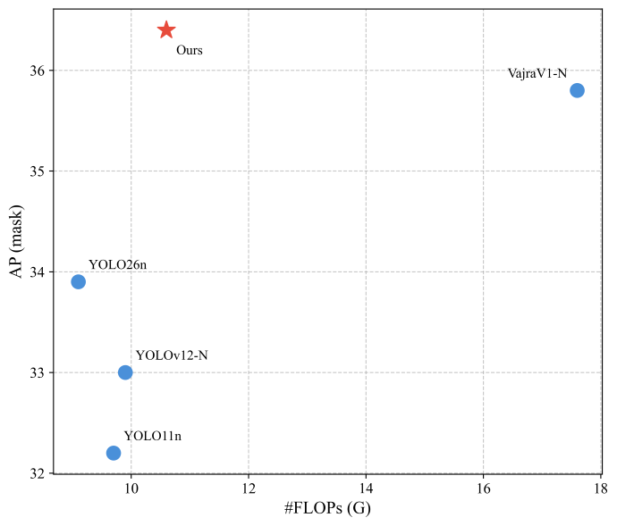

<h2 align="center">
  Lightweight Real-Time Object Detection with Multiscale Feature Enhancement and Looped Transformers
</h2>

<p align="center">
    <a href="https://github.com/huangpaipai98/DEIMv2-Nano-improve/blob/main/LICENSE">
        
    </a>
    <a href="mailto:huangpaipai98@163.com">
        
    </a>
</p>

<p align="center">
    Nanoscale object detectors enable deployment under stringent resource constraints, but limited model capacity can hinder small-object detection. Using DEIMv2-Nano as the baseline, we coordinate backbone lightweighting, multiscale feature enhancement, and recurrent computation. We remove stage 4, reorganize the backbone outputs into three scales, and apply downsampling to retain high-resolution information with fewer parameters. HyperACE and FullPAD enhance higher-order global semantics and local fine-grained representations. Weight-shared Looped Transformers in AIFI and the first two decoder layers increase effective computational depth without adding learnable parameters. A lightweight segmentation head further supports joint object detection and instance segmentation. On the COCO 2017 validation set, the detector achieves 45.6 AP with 2.94 M parameters and 3.14 ms end-to-end latency, while the segmentation model achieves 44.8 AP@box and 36.4 AP@mask with 6.91 ms latency. VisDrone-DET experiments and ablations confirm improved small-object detection and complementary effects among the proposed components.
</p>

---


<div align="center">
  <a href="https://github.com/huangpaipai98">Paipai Huang</a>,&nbsp;&nbsp;
  Lei Yu<sup>†</sup>&nbsp;&nbsp;
</div>

  
<p align="center">
<i>
College of Computer Science and Technology, Huaibei Normal University, Huaibei 235000, China &nbsp; <br> 
† Corresponding Author
</i>
</p>


<p align="center">
  
  
</p>
<p align="center">
  
  
</p>

</details>


## 🧭 Table of Content
* [1. 🤖 Model](#1-model)
* [2. ⚡ Quick Start](#2-quick-start)
* [3. 🛠️ Usage](#3-usage)
* [4. 🧰 Tools](#4-tools)
  
  
## 1. Model

| Task | Dataset | AP | AP@mask | #Params | GFLOPs | Latency (ms) | config | checkpoint | log |
| :---: | :---: | :---: | :---: | :---: | :---: |:------------:| :---: | :---: | :---: |
| **Detection** | COCO | **45.6** | - | 2.94M | 9.11 | 3.14 | [yml](./configs/deimv2_improve/deimv2_hgnetv2_n_improve_coco.yml) | [Download](https://github.com/huangpaipai98/DEIMv2-Nano-improve/releases/download/v1.0.0/deimv2_hgnetv2_n_improve_coco_stg2.pth) | [Download](https://github.com/huangpaipai98/DEIMv2-Nano-improve/releases/download/v1.0.0/deimv2_hgnetv2_n_improve_coco.log) |
| **Segmentation** | COCO | **44.8** | **36.4** | 3.16M | 10.60 | 6.91 | [yml](./configs/deimv2_improve/deimv2_hgnetv2_n_improve_coco_seg.yml) | [Download](https://github.com/huangpaipai98/DEIMv2-Nano-improve/releases/download/v1.0.0/deimv2_hgnetv2_n_improve_coco_seg_stg2.pth) | [Download](https://github.com/huangpaipai98/DEIMv2-Nano-improve/releases/download/v1.0.0/deimv2_hgnetv2_n_improve_coco_seg.log) |
| **Detection** | VisDrone | **19.1** | - | 2.91M | 8.96 | - | [yml](./configs/deimv2_improve/deimv2_hgnetv2_n_improve_visdrone.yml) | - | - |


## 2. Quick start

### 2.1 Environment Setup

```shell
# You can use PyTorch 2.13.0. We have not tried other versions.

conda create -n deimv2-Nano-improve python=3.12 -y
conda activate deimv2-Nano-improve
pip install -r requirements.txt # -i https://pypi.tuna.tsinghua.edu.cn/simple/
```


### 2.2 Data Preparation

<details open>
<summary> 2.2.1 COCO2017 Dataset </summary>

Follow the steps below to prepare COCO dataset:

1. Download COCO2017 from [ModelScope](https://www.modelscope.cn/datasets/PAI/COCO2017/files) or [COCO](https://cocodataset.org/#download).
2. Modify paths in [deimv2_hgnetv2_n_improve_coco.yml](./configs/deimv2_improve/deimv2_hgnetv2_n_improve_coco.yml)

    ```yaml
    train_dataloader:
        img_folder: ../data/COCO2017/train2017/
        ann_file: ../data/COCO2017/annotations/instances_train2017.json
    val_dataloader:
        img_folder: ../data/COCO2017/val2017/
        ann_file: ../data/COCO2017/annotations/instances_val2017.json
    ```

</details>


<details open>
<summary> 2.2.2 VisDrone-DET Dataset </summary>

Follow the steps below to prepare VisDrone dataset:

1. Download VisDrone-DET from [BaiduYun](https://pan.baidu.com/s/1K-JtLnlHw98UuBDrYJvw3A) or [GoogleDrive](https://drive.google.com/file/d/1a2oHjcEcwXP8oUF95qiwrqzACb2YlUhn/view?usp=sharing). <br>
   Download annotations converted to COCO format from [releases](https://github.com/huangpaipai98/DEIMv2-Nano-improve/releases/download/v1.0.0/annotations_VisDrone2019-Det.zip).
2. Modify paths in [deimv2_hgnetv2_n_improve_visdrone.yml](./configs/deimv2_improve/deimv2_hgnetv2_n_improve_visdrone.yml)

    ```yaml
    train_dataloader:
        img_folder: ../data/VisDrone2019-DET/train/
        ann_file: ../data/VisDrone2019-DET/annotations/instances_train.json
    val_dataloader:
        img_folder: ../data/VisDrone2019-DET/test-dev/
        ann_file: ../data/VisDrone2019-DET/annotations/instances_test-dev.json
    ```

</details>


<details>
<summary>2.2.3 (Optional) Custom Dataset</summary>

To train on your custom dataset, you need to organize it in the COCO format. Follow the steps below to prepare your dataset:

1. **Set `remap_mscoco_category` to `False`:**

    This prevents the automatic remapping of category IDs to match the MSCOCO categories.

    ```yaml
    remap_mscoco_category: False
    ```

2. **Organize Images:**

    Structure your dataset directories as follows:

    ```shell
    yourdataset/
    ├── train/
    │   ├── image1.jpg
    │   ├── image2.jpg
    │   └── ...
    ├── val/
    │   ├── image1.jpg
    │   ├── image2.jpg
    │   └── ...
    └── annotations/
        ├── instances_train.json
        ├── instances_val.json
        └── ...
    ```

    - **`train/`**: Contains all training images.
    - **`val/`**: Contains all validation images.
    - **`annotations/`**: Contains COCO-formatted annotation files.

3. **Convert Annotations to COCO Format:**

    If your annotations are not already in COCO format, you'll need to convert them. You can use the following Python script as a reference or utilize existing tools:

    ```python
    import json

    def convert_to_coco(input_annotations, output_annotations):
        # Implement conversion logic here
        pass

    if __name__ == "__main__":
        convert_to_coco('path/to/your_annotations.json', '../data/yourdataset/annotations/instances_train.json')
    ```

4. **Update Configuration Files:**

    Modify your [custom_detection.yml](./configs/dataset/custom_detection.yml).

    ```yaml
    task: detection

    evaluator:
      type: CocoEvaluator
      iou_types: ['bbox', ]

    num_classes: 777 # your dataset classes
    remap_mscoco_category: False

    train_dataloader:
      type: DataLoader
      dataset:
        type: CocoDetection
        img_folder: ../data/yourdataset/train
        ann_file: ../data/yourdataset/annotations/instances_train.json
        return_masks: False
        transforms:
          type: Compose
          ops: ~
      shuffle: True
      num_workers: 4
      drop_last: True
      collate_fn:
        type: BatchImageCollateFunction

    val_dataloader:
      type: DataLoader
      dataset:
        type: CocoDetection
        img_folder: ../data/yourdataset/val
        ann_file: ../data/yourdataset/annotations/instances_val.json
        return_masks: False
        transforms:
          type: Compose
          ops: ~
      shuffle: False
      num_workers: 4
      drop_last: False
      collate_fn:
        type: BatchImageCollateFunction
    ```

</details>

### 2.3 Backbone Preparation

- **HGNetv2**: Backbones will be downloaded automatically during training, so you don't need to worry.

Place hgnetv2 into ./weight/hgnetv2 folder as:

```shell
weight/hgnetv2/
└── PPHGNetV2_B0_stage1.pth
```


## 3. Usage
<details open>
<summary> 3.1 COCO2017 </summary>

1. Training
    ```shell
    ulimit -n 65536 && CUDA_VISIBLE_DEVICES=0,1,2,3 torchrun --master_port=7777 --nproc_per_node=4 train.py -c configs/deimv2_improve/deimv2_hgnetv2_n_improve_coco.yml --use-amp --seed=0
    ```

2. Testing
    ```shell
    ulimit -n 65536 && CUDA_VISIBLE_DEVICES=0,1,2,3 torchrun --master_port=7777 --nproc_per_node=4 train.py -c configs/deimv2_improve/deimv2_hgnetv2_n_improve_coco.yml --test-only -r model.pth
    ```

3. Tuning
    ```shell
    ulimit -n 65536 && CUDA_VISIBLE_DEVICES=0,1,2,3 torchrun --master_port=7777 --nproc_per_node=4 train.py -c configs/deimv2_improve/deimv2_hgnetv2_n_improve_coco.yml --use-amp --seed=0 -t model.pth
    ```
</details>

<details open>
<summary> 3.2 VisDrone-DET </summary>

0. Modify mscoco_category2name in [coco_dataset.py](./engine/data/dataset/coco_dataset.py)
    ```shell
    mscoco_category2name = {
        1: 'pedestrian',
        2: 'people',
        3: 'bicycle',
        4: 'car',
        5: 'van',
        6: 'truck',
        7: 'tricycle',
        8: 'awning-tricycle',
        9: 'bus',
        10: 'motor',
        11: 'others'
    }
    ```

1. Training
    ```shell
    CUDA_VISIBLE_DEVICES=0,1,2,3 torchrun --master_port=7777 --nproc_per_node=4 train.py -c configs/deimv2_improve/deimv2_hgnetv2_n_improve_visdrone.yml --use-amp --seed=0
    ```

2. Testing
    ```shell
    CUDA_VISIBLE_DEVICES=0,1,2,3 torchrun --master_port=7777 --nproc_per_node=4 train.py -c configs/deimv2_improve/deimv2_hgnetv2_n_improve_visdrone.yml --test-only -r model.pth
    ```

3. Tuning
    ```shell
    CUDA_VISIBLE_DEVICES=0,1,2,3 torchrun --master_port=7777 --nproc_per_node=4 train.py -c configs/deimv2_improve/deimv2_hgnetv2_n_improve_visdrone.yml --use-amp --seed=0 -t model.pth
    ```
</details>

<details>
<summary> 3.3 (Optional) Customizing Batch Size </summary>

If you want to use **DEIMv2-Nano-improve** and  double the total batch size to 256 when training **DEIMv2-Nano-improve** on COCO2017, here are the steps you should follow:

1. **Modify your [deimv2_hgnetv2_n_improve_coco.yml](./configs/deimv2_improve/deimv2_hgnetv2_n_improve_coco.yml)** to increase the `total_batch_size`:

    ```yaml
    train_dataloader:
      total_batch_size: 256 
      dataset: 
        transforms:
          ops:
            ...
    
      collate_fn:
        ...
    ```

2. **Modify your [deimv2_hgnetv2_n_improve_coco.yml](./configs/deimv2_improve/deimv2_hgnetv2_n_improve_coco.yml)**. Here’s how the key parameters should be adjusted:

    ```yaml
    optimizer:
      type: AdamW
    
      params: 
        -
          params: '^(?=.*backbone)(?!.*norm|bn).*$'
          lr: 0.00085  # doubled, quadratic scaling law
        -
          params: '^(?=.*backbone)(?=.*norm|bn).*$'
          lr: 0.00085   # doubled, quadratic scaling law
          weight_decay: 0.
        - 
          params: '^(?=.*(?:encoder|decoder))(?=.*(?:norm|bn|bias)).*$'
          weight_decay: 0.
    
      lr: 0.0012   # quadratic scaling law if needed
      betas: [0.9, 0.999]
      weight_decay: 0.0001
   
    ema:  # added EMA settings
      decay: 0.9998  # adjusted by 1 - (1 - original decay) * 2
      warmups: 500  # halved
   
    lr_warmup_scheduler:
      warmup_duration: 250  # halved
    ```

</details>


<details>
<summary> 3.4 (Optional) Customizing Input Size </summary>

If you'd like to train **DEIMv2-Nano-improve** on COCO2017 with an input size of 320x320, follow these steps:

1. **Modify your  [deimv2_hgnetv2_n_improve_coco.yml](./configs/deimv2_improve/deimv2_ghnetv2_n_improve_coco.yml)**:

    ```yaml
    eval_spatial_size: [320, 320]
   
    train_dataloader:
      # Here we set the total_batch_size to 256 as an example.
      total_batch_size: 256 
      dataset: 
        transforms:
          ops:
            #  Especially for Mosaic augmentation, it is recommended that output_size = input_size / 2.
            - {type: Mosaic, output_size: 160, rotation_range: 10, translation_range: [0.1, 0.1], scaling_range: [0.5, 1.5],
               probability: 1.0, fill_value: 0, use_cache: True, max_cached_images: 50, random_pop: True}
            ...
            - {type: Resize, size: [320, 320], }
            ...
        collate_fn:
          base_size: 320
          ...

    val_dataloader:
      dataset:
        transforms:
          ops:
            - {type: Resize, size: [320, 320], }
            ...
    ```
   
</details>

<details>
<summary> 3.5 (Optional) Customizing Epoch </summary>

If you want to finetune **DEIMv2-Nano-improve** for **20** epochs, follow these steps (for reference only; feel free to adjust them according to your needs):

```yml
epoches: 32 #  Total epochs: 20 for training + EMA  for 4n = 12. n refers to the model size in the matched config.

flat_epoch: 14    # 4 + 20 // 2
no_aug_epoch: 12  # 4n

train_dataloader:
  dataset: 
    transforms:
      ops:
        ...
      policy:
        epoch: [4, 14, 20]   # [start_epoch, flat_epoch, epoches - no_aug_epoch]

  collate_fn:
    ...
    mixup_epochs: [4, 14]  # [start_epoch, flat_epoch]
    stop_epoch: 20  # epoches - no_aug_epoch
    copyblend_epochs: [4, 20]  # [start_epoch, epoches - no_aug_epoch]
  
DEIMCriterion:
  matcher:
    ...
    matcher_change_epoch: 18  # ~90% of (epoches - no_aug_epoch)
```

</details>

## 4. Tools
<details>
<summary> 4.1 Deployment </summary>

1. Setup
    ```shell
    pip install onnx onnxsim tensorrt==10.16.1.11
    ```

2. Export onnx
    ```shell
    python tools/deployment/export_onnx.py --check -c configs/deimv2_improve/deimv2_hgnetv2_n_improve_coco.yml -r model.pth
    ```

3. Export engine
    ```shell
    python tools/deployment/export_engine.py -p onnx_folder_path --fp16
    ```

⚠️ **TensorRT Version Notes**

- ✅ Recommended: **Use TensorRT = 10.16.1.11 for FP16 inference** to ensure stable execution and correct detection results.


</details>

<details>
<summary> 4.2 Inference (Visualization) </summary>


1. Setup
    ```shell
    pip install -r tools/inference/requirements.txt
    ```


2. Inference (onnxruntime / tensorrt / torch)

    Inference on images and videos is now supported.

    ```shell
    python tools/inference/onnx_inf.py --onnx model.onnx --input image.jpg  # video.mp4
    python tools/inference/trt_inf.py --trt model.engine --input image.jpg
    python tools/inference/torch_inf.py -c configs/deimv2_improve/deimv2_hgnetv2_n_improve_coco.yml -r model.pth --input image.jpg --device cuda:0
    ```
</details>

<details>
<summary> 4.3 Benchmark </summary>

1. Setup
    ```shell
    pip install -r tools/benchmark/requirements.txt
    conda install -c conda-forge pycuda
    ```

2. Model FLOPs, MACs, and Params
    ```shell
    python tools/benchmark/get_info.py -c configs/deimv2_improve/deimv2_hgnetv2_n_improve_coco.yml
    ```

2. TensorRT Latency
    ```shell
    python tools/benchmark/trt_benchmark.py --engine_dir  engine_folder_path --COCO_dir ../data/COCO2017/val2017
    ```
</details>

<details>
<summary> 4.4 Fiftyone Visualization  </summary>

1. Setup
    ```shell
    pip install fiftyone
    ```
2. Voxel51 Fiftyone Visualization ([fiftyone](https://github.com/voxel51/fiftyone))
    ```shell
    python tools/visualization/fiftyone_vis.py -c configs/deimv2_improve/deimv2_hgnetv2_n_improve_coco.yml -r model.pth
    ```
</details>

<details>
<summary> 4.5 Others </summary>

1. Auto Resume Training
    ```shell
    bash reference/safe_training.sh
    ```

2. Converting Model Weights
    ```shell
    python reference/convert_weight.py model.pth
    ```
</details>